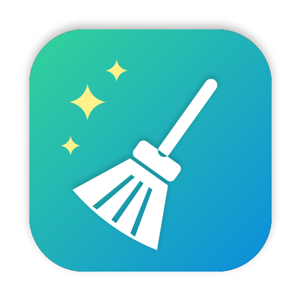
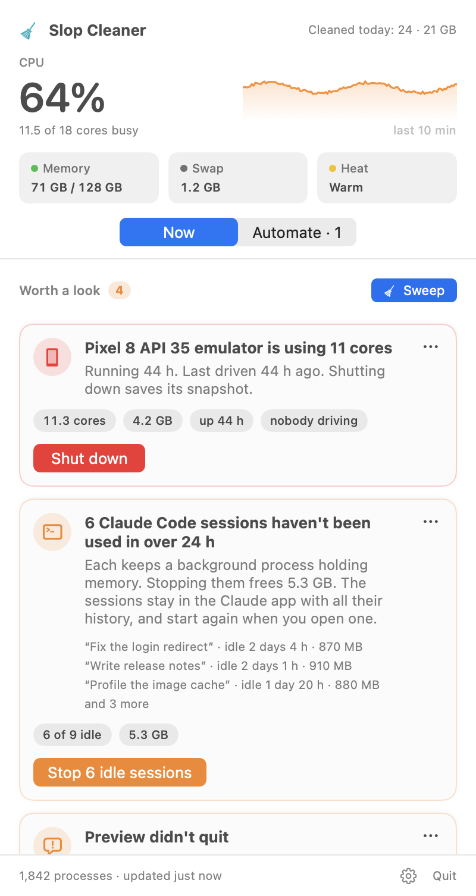
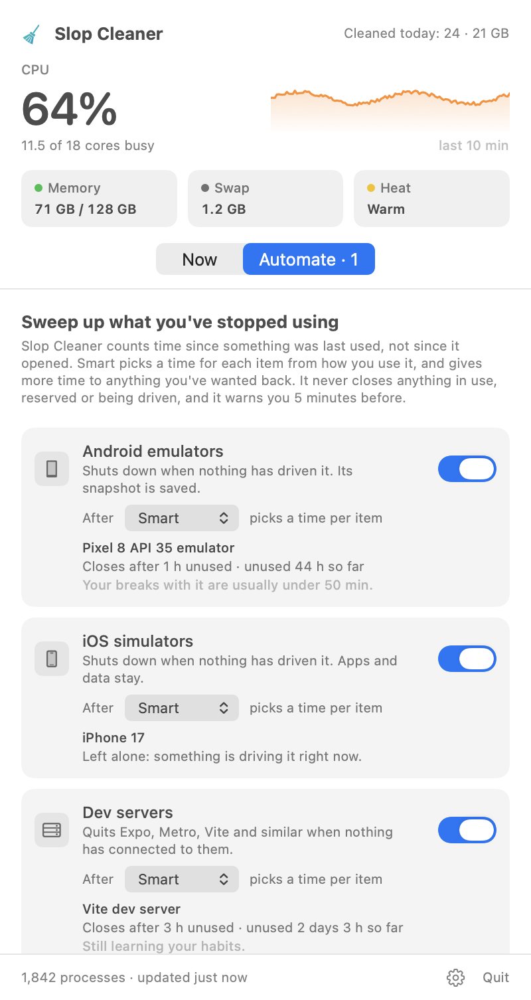

<p align="center"></p>

<h1 align="center">Slop Cleaner</h1>

<p align="center">A little broom in your Mac's menu bar that keeps CPU and RAM clean.<br>
It notices what's been left running (idle emulators, old dev servers, forgotten AI agent sessions, stuck processes) and helps you clear it, without ever touching what you're using.</p>

<p align="center">
  
  &nbsp;
  
</p>

## Why

When you work with AI coding agents, a lot gets left behind: an Android emulator idling at 11 cores, a dev server from last week, dozens of agent sessions each holding a gigabyte. Your fans spin up and you don't know why. Slop Cleaner watches quietly (about 1% of one CPU core) and tells you, in plain words, what's worth shutting down.

## What it does

- **Shows what's using your Mac**: CPU, memory, swap and heat at a glance, with every app, emulator, simulator, dev server and agent session grouped into things you recognize. Search by name, port or pid.
- **Tells you when something is worth stopping**, with a Mac notification and a button that does it:
  - an Android emulator or iOS simulator burning CPU that nothing is driving,
  - a dev server (Expo, Metro, Vite, Next, Uvicorn…) nothing has connected to in a long time,
  - a process stuck at 100% of a core,
  - idle Claude Code sessions holding memory,
  - leftover agent tools (headless browsers, MCP servers) whose session already ended,
  - real memory pressure (not just swap, which is normal on a Mac).
- **Last used, for everything**: last in front for apps, last client for servers, last driven for emulators, last activity for Claude sessions. When it hasn't seen something used, it says "since Slop Cleaner started", never more than it knows.
- **Sweep**: one button cleans everything on the list that's safe right now. It never includes your apps.
- **Automate**: optionally close things after they've gone *unused* (not just open) for a while, with a 5-minute heads-up and a "Keep it running" button.
- **Smart timing**: instead of one fixed number, it learns how you use each item (your usual breaks with it) and gives more time to anything you brought back after it was closed. What it costs while it waits caps the wait: something burning a core or more gets 2 hours at most, so an emulator you only come back to every other day doesn't idle at 7 cores in between. What it learns stays on your Mac.
- **Answers "why are my fans loud?"**: when your Mac is warm or busy, it shows where the load comes from (work in progress like builds and agent sessions, devices and servers left running that nothing is using, macOS's own background jobs like Spotlight and Photos analysis, your apps), even when nothing is safe to clean.
- **Flags apps that don't close**: if an app is asked to quit and stays open (usually it's asking about unsaved work), it shows up on the list with a "Show it" button.

## Your apps are yours

Apps you open yourself (Spotify, your browser, your editor, Slack…) are never closed for you. Slop Cleaner tells them apart by where they live: anything inside an app bundle (like `/Applications/Spotify.app`) is that app, and the things it cleans up are recognized by what they are (an Android emulator process, a simulator, a dev server like Vite or Expo, a Claude Code session). Automate has no setting for apps at all, Sweep skips them, and an app that's open but idle is never even suggested. The one exception: if an app's main process is stuck at a full CPU core for 15+ minutes while you're not using it, you'll see a card, and only if you click its Quit button does it get a polite ⌘Q (it can still ask you about unsaved work).

## It never breaks what you're using

Every stop goes through one final check, made at that moment, that nothing can get around (not a button, not Sweep, not Automate). It refuses to stop:

- **anything that's part of macOS** (WindowServer, Finder, Dock, launchd…), anything owned by the system or another user, or signed by Apple as part of the OS,
- **anything in use right now**: the app in front (and its tabs and helpers), anything with a connection open to it, an emulator or simulator being driven by tests, a Claude session used in the last 30 minutes and anything it started,
- **parts of an app** (browser tabs, helpers, extensions, an app's own background work). It only ever quits a whole app politely (like ⌘Q) so the app can ask about unsaved work. It never force-quits an app,
- **your shells and terminals, databases** (Postgres, Redis, MySQL…), **Docker**, the Claude app, and itself.

Background plumbing doesn't count as use: adb's server stays connected to every emulator, a simulator panel or log viewer only watches, and an idle `idb_companion` often outlives its last command. Driving means an `adb` command, Maestro, a test run, `xcodebuild` or `simctl` acting on the device.

Emulators are shut down with `adb emu kill` (their snapshot is saved) and simulators with `simctl shutdown` (apps and data stay). Claude Code sessions in the Claude desktop app keep all their history and start again when you open them. Sessions you run in a terminal are shown but never stopped.

## Install

You build it on your own Mac (it takes about a minute). You need:

- macOS 15 or later
- Xcode, from the App Store (open it once after installing so it can finish setting up)
- [Homebrew](https://brew.sh)

Then, in Terminal:

```bash
brew install xcodegen
git clone https://github.com/Jaiashar/slop-cleaner.git
cd slop-cleaner
./scripts/build.sh
```

That builds the app, puts it in `~/Applications/Slop Cleaner.app` and opens it. Look for the broom in your menu bar and click it. When macOS asks, allow notifications.

If you'd like it to start with your Mac: click the broom, then the gear icon, and turn on **Open at login**.

**Update** to the latest version:

```bash
cd slop-cleaner && git pull && ./scripts/build.sh
```

**Uninstall**: quit it from its menu (Quit), then:

```bash
rm -rf ~/Applications/"Slop Cleaner.app" ~/Library/Application\ Support/"Slop Cleaner"
defaults delete io.github.jaiashar.slopcleaner
```

## Using it

- **Click the broom** to see what's running and what's worth a look. The menu bar broom gets little dust specks as your CPU gets busier, and an orange or red dot when there's something to clean.
- **Click a row** to see when it was last used, why it is or isn't safe to stop, and what stopping it does.
- **Cards** have a button (Shut down, Quit, Stop…) and a ⋯ menu to snooze or never suggest that again.
- **Automate** tab: turn on the kinds of things you'd like closed automatically. Apps and system processes are never closed automatically.
- **Settings** (gear icon): how quick it is to speak up (Relaxed / Normal / Eager), notifications, quiet hours, open at login, and the list of things you said not to suggest again.

## Privacy

Everything stays on your Mac. Slop Cleaner makes no network connections. It reads process information from macOS, and, if you use the Claude desktop app, that app's local session records (read-only) to show session names and when they were last used. Its own data (an action log, recent history and learned habits) lives in `~/Library/Application Support/Slop Cleaner/`.

## Notes

- Signing: `build.sh` uses your Apple Development certificate if you have one, otherwise it signs the app for your Mac only. Both work.
- If notifications don't appear, check System Settings → Notifications → Slop Cleaner.
- Built and tested on macOS 27 with Xcode 27 on Apple silicon. The app is built for both Apple silicon and Intel.
- Optional, for teams sharing test devices: if a device is "reserved" by a lock folder, Slop Cleaner won't stop it. See `Sources/Grouping/DeviceInfo.swift`.

## For developers

```bash
./scripts/build.sh test        # 51 unit tests, including the safety guard checked against real system processes
./scripts/snapshot.sh out.png  # render the running app's popover to a PNG ("demo" renders made-up data)
./scripts/make-icon.sh         # regenerate the app icon
```

The code is SwiftUI + AppKit with no dependencies. `project.yml` (XcodeGen) generates the Xcode project.

- `Sources/Sampling`: reads processes, sockets and system stats (libproc, sysctl)
- `Sources/Grouping`: turns ~2,000 processes into things you recognize
- `Sources/Rules`: what's worth suggesting, safety, Smart timing
- `Sources/Actions/Guard.swift`: the final check before anything is stopped
- `Sources/UI`: the popover, cards, Automate and settings

## License

MIT. See [LICENSE](LICENSE).
